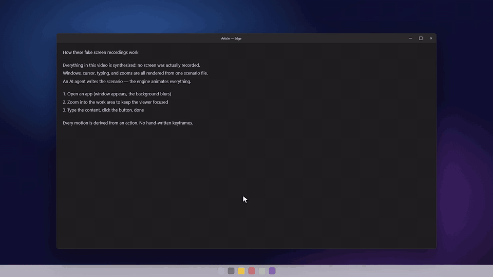

# Fake Screen Studio

[](https://github.com/MuhSaider/fake-screen-studio/actions/workflows/ci.yml)
[](https://www.npmjs.com/package/fake-screen-studio)
[](LICENSE)

Generate tutorial videos that look like screen recordings — without recording a screen.
Windows, cursor movement, typing, click ripples, and zooms are all synthesized from a
single JSON **scenario** file, previewed live in the browser, then rendered to MP4 frame
by frame.



There is no screen capture and no video editor timeline: the engine computes the state of
the fake desktop at time `t`, the browser draws it, and a headless browser screenshots it
one frame at a time. The result is deterministic — the same scenario always produces the
same video.

Designed to be driven by an AI agent: the scenario format is small, strictly validated,
and documented by a generated component index.

## Quick start

```bash
npx fake-screen-studio my-video
cd my-video
npm run dev     # live preview at http://localhost:5173
npm run render  # -> dist/hello.mp4
```

The scaffolder copies the engine, the render pipeline, the docs, and a 9-second starter
scenario into a new directory, then runs `npm install`. Pass `--no-install` to skip the
install, or `--name <package-name>` to override the generated package name.

### Requirements

- **Node.js 22 or newer**
- **Chrome, Edge, Chromium, or Brave.** The renderer looks in the usual per-OS install
  locations and on `PATH`. If your browser is elsewhere, point `STUDIO_BROWSER` at the
  executable:
  ```bash
  # macOS/Linux
  export STUDIO_BROWSER=/path/to/chrome
  # Windows (PowerShell)
  $env:STUDIO_BROWSER = "C:\Program Files\Google\Chrome\Application\chrome.exe"
  ```
- **ffmpeg** is installed automatically by [`ffmpeg-static`](https://www.npmjs.com/package/ffmpeg-static)
  during `npm install` (roughly 80 MB, downloaded once).

## Writing a scenario

Scenarios live at `scenarios/<video-name>/scenario.json`. A minimal one:

```json
{
  "name": "hello",
  "duration": 9,
  "fps": 60,
  "width": 1920,
  "height": 1080,
  "windows": [
    {
      "id": "app",
      "template": "generic",
      "title": "Notepad",
      "rect": { "x": 540, "y": 300, "width": 840, "height": 520 },
      "content": { "lines": ["Hello from a JSON file."] }
    }
  ],
  "actions": [
    { "type": "open_window", "window": "app", "at": 1.2 },
    { "type": "type_text", "window": "app", "text": "Typed by the engine.", "at": 3.0 }
  ],
  "zoomShots": [
    { "preset": "zoom-to-detail", "start": 2.6, "target": { "window": "app", "anchor": "body" } },
    { "preset": "zoom-out-overview", "start": 6.4, "target": null }
  ]
}
```

Before writing or editing a scenario, read
[`docs/agents/video-index.md`](https://github.com/MuhSaider/fake-screen-studio/blob/main/docs/agents/video-index.md). It lists every action type,
zoom preset, window template, and click anchor the engine supports. The index is
generated from [`src/registry/index.ts`](https://github.com/MuhSaider/fake-screen-studio/blob/main/src/registry/index.ts) — if a component is
missing, add it to the registry and its handler, then run `npm run gen:index`. Never
invent fields ad hoc; scenario validation is strict and unknown components are hard
errors.

Timing is in **seconds**; coordinates are in a **1920×1080** space with a top-left
origin. Gestures (cursor path, click ripple, typing rhythm) are derived from actions;
they are not authored by hand.

## Commands

| Command | What it does |
| --- | --- |
| `npm run dev` | Vite preview at `http://localhost:5173`, live-reloads scenario changes |
| `npm run render` | Renders the first scenario it finds to `dist/<name>.mp4` |
| `npm run render -- scenarios/demo/scenario.json` | Renders a specific scenario |
| `npm run gen:index` | Regenerates `docs/agents/video-index.md` from the registry |
| `npm run build` | Production build of the preview app |
| `npm test` | Packaging/scaffold tests |

A 9-second 1080p60 video takes roughly 2 minutes to render on a typical laptop; rendering
is CPU-bound on screenshots and x264.

## How it works

1. The scenario is validated against the registry in `src/registry/`.
2. The engine builds a deterministic timeline and can be asked for the full visual state
   at any timestamp (`window.__studio.seek(t)`).
3. `npm run dev` lets you scrub that timeline interactively.
4. `npm run render` starts Vite, launches a headless browser, seeks frame by frame,
   screenshots each frame, and pipes the PNG sequence into ffmpeg.

The reasoning behind the main design choices is recorded in
[`docs/adr/0001-render-frame-by-frame.md`](https://github.com/MuhSaider/fake-screen-studio/blob/main/docs/adr/0001-render-frame-by-frame.md) and
[`docs/adr/0002-scenario-as-json.md`](https://github.com/MuhSaider/fake-screen-studio/blob/main/docs/adr/0002-scenario-as-json.md).

## Project structure

```
scenarios/          one directory per video, each with scenario.json
src/
  engine/           timeline, camera/zoom, cursor, rendering
  registry/         the component catalogue (source of the video index)
  scenario/         scenario types and validation
scripts/
  render.mjs        headless render pipeline (Vite + puppeteer-core + ffmpeg)
  gen-index.ts      generates docs/agents/video-index.md
docs/
  adr/              architecture decisions
  agents/           agent-facing docs (video index, issue tracker, domain docs)
bin/                the npx scaffolder
test/               packaging contract tests
```

## Scaffolding without `npx`

The npm package is the template. To start from a clone instead:

```bash
git clone https://github.com/MuhSaider/fake-screen-studio.git my-video
cd my-video
rm -rf .git
npm install
```

Do not copy an existing project directory that already contains rendered output or
`node_modules` — use the CLI so repository-only files are excluded.

## Troubleshooting

**`No Chrome, Edge, Chromium, or Brave found`** — install a browser or set
`STUDIO_BROWSER` (see [Requirements](#requirements)).

**`npm install` skipped install scripts** — recent npm versions can block lifecycle
scripts. Approve the packages that need them and rebuild:

```bash
npm approve-scripts ffmpeg-static esbuild
npm rebuild
```

**Frames look different across machines** — font availability affects text metrics. The
engine uses system UI fonts; render on the machine that will publish the video.

## Contributing

Issues and pull requests are welcome. Read [CONTRIBUTING.md](https://github.com/MuhSaider/fake-screen-studio/blob/main/CONTRIBUTING.md) first, and
keep the [Code of Conduct](https://github.com/MuhSaider/fake-screen-studio/blob/main/CODE_OF_CONDUCT.md) in mind. Security reports go through
[SECURITY.md](https://github.com/MuhSaider/fake-screen-studio/blob/main/SECURITY.md), not the public issue tracker.

## License

[MIT](LICENSE)
